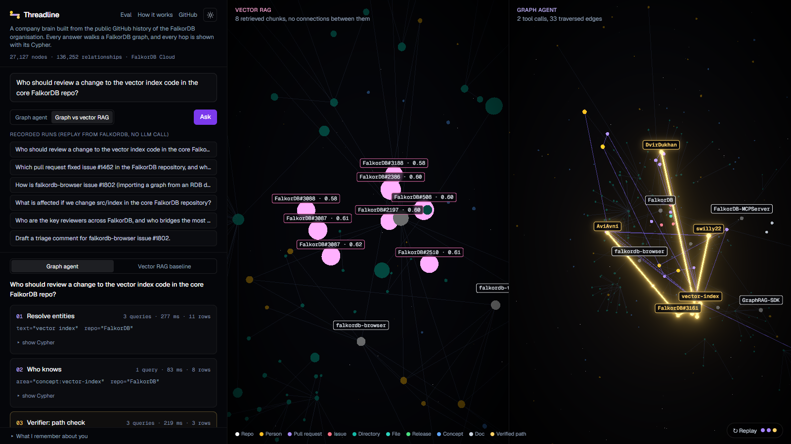
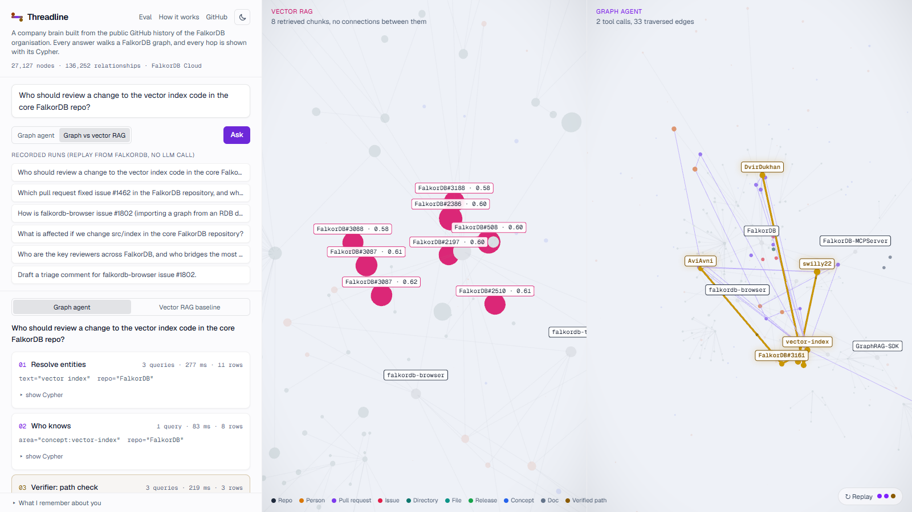
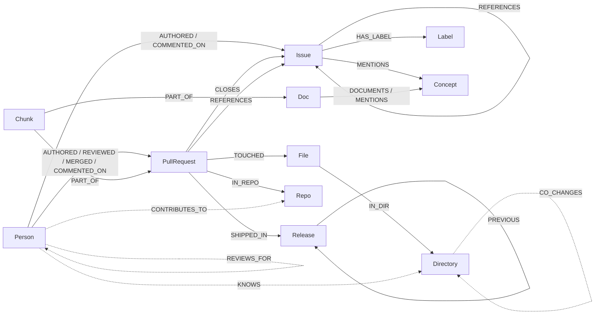
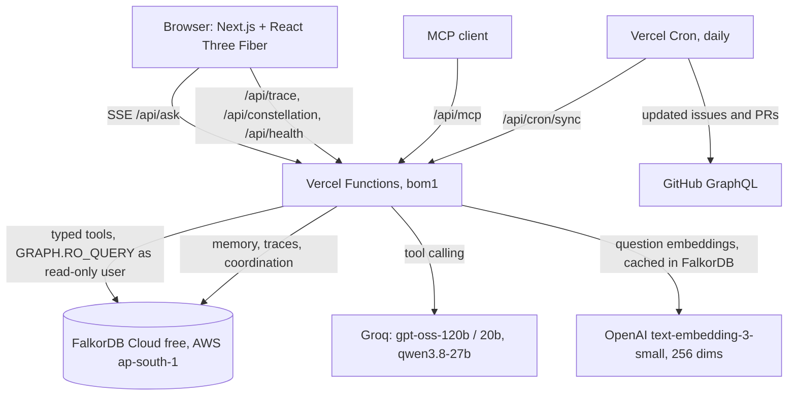

# Threadline

**A company brain that shows its work.** Threadline loads the public GitHub history of the FalkorDB organisation (six repositories plus the docs) into a FalkorDB graph of people, pull requests, issues, reviews, files, releases, docs and concepts. Ask "who should review a change to the vector index code?" and an agent walks the graph to answer. Every hop is replayed in 3D with the exact Cypher it ran, and a verifier checks that each cited node is really connected to the question before the answer gets a gold badge.

- **Live:** https://threadline-graph.vercel.app
- **Demo video:** _link added at submission_
- **Blog post:** _link added at submission_
- **Tracks entered:** Company Brain (primary), Agents That Act on Connected Data, Agent Memory and Coordination
- Built for [WeMakeDevs Graph Hacks](https://www.wemakedevs.org/hackathons/falkordb), 15 to 18 October 2026.



<details><summary>Light theme</summary>



</details>

## What it does

- **Answers questions about how an open-source company works:** who knows an area of the code, which PR fixed an issue and which release shipped it, how a browser issue connects to work in the core repo, what is affected if a directory changes, who reviews the most, who bridges repositories.
- **Shows the path behind every answer.** The agent's tool calls stream to the browser. Each step lights up the nodes it touched in a 3D constellation of the org, with travelling pulses along the edges it traversed, and a card with the Cypher, parameters, row count and timing.
- **Verifies its citations with the graph.** A Verifier agent checks that every cited node appeared in a tool result and is reachable from the question's entry nodes within four hops (one `allShortestPaths` query per citation). Rejected claims go back to the Investigator once, and the handoff is recorded.
- **Compares itself to vector RAG.** The "Graph vs vector RAG" mode runs both on the same question: the vector baseline's chunks float unconnected on the left, the graph path on the right.
- **Remembers.** Each visitor gets their own FalkorDB graph for episodic memory (turns and their tool calls), semantic memory (facts stated by the user, such as "I work on the TypeScript client") and follow-ups ("same question, but for QueryWeaver"). Verified tool sequences become shared procedural playbooks.
- **Acts.** `draft_triage` turns an open issue into a ready-to-paste triage comment: likely duplicates, suggested reviewers (from who changed the same code when similar issues were fixed) and suggested labels. Nothing is posted anywhere.
- **Speaks MCP.** The same typed graph tools are served over MCP at `/api/mcp`, so any MCP client can use them.
- **Light and dark themes.** Dark is the default; the header toggle switches the whole app, including the 3D stage, and the choice is remembered without a flash of the wrong theme. Every page passes an automated WCAG AA contrast check in both themes (`node scripts/a11y.mjs`).
- **Stays current.** A daily Vercel Cron job merges issues and PRs updated since the last run, recomputes derived edges and prunes idle memory graphs. It also counts as daily use of the free FalkorDB instance.

## Why a graph

<!-- EVAL:START -->
Method: 60 questions in six categories, generated from templates over the raw GitHub JSON. Gold answers are computed by `eval/gold.ts` from that JSON without FalkorDB, so the graph never grades itself. Both systems use the same model, the same 256-dimension embeddings and the same FalkorDB vector index; scores are set-based F1 over each answer's final ANSWER line.

Run in progress: 31 of 60 questions answered by both systems so far (the rest resume as each model's daily Groq cap refills). These numbers cover finished pairs only. Models: qwen/qwen3.8-27b (7 pairs), openai/gpt-oss-120b (24 pairs).

| Category | Pairs | Graph agent F1 | Vector RAG F1 |
|---|---|---|---|
| Single-hop lookup (control) | 7 | 1.00 | 0.43 |
| Expertise (PR to file to directory) | 7 | 0.76 | 0.00 |
| Decision trace (issue to PR to release) | 5 | 0.80 | 0.00 |
| Cross-repo connection | 4 | 1.00 | 0.00 |
| Impact (open PRs under a directory) | 4 | 0.50 | 0.00 |
| Aggregation (top reviewers or openers) | 4 | 1.00 | 0.00 |
| **All** | **31** | **0.85** | **0.10** |

The graph agent used about 5,721 tokens per answer against 1,533 for the baseline. 96 percent of the graph agent's citations were verified by a graph path. The vector baseline does best on single-hop lookup questions (F1 0.43), the control category where the answer sits in one document. Widest gap: cross-repo connection and aggregation. Every question, gold answer, raw answer and score is in [`eval/`](eval/) and on [/eval](https://threadline-graph.vercel.app/eval).
<!-- EVAL:END -->

## Graph data model

Brain graph `threadline` (about 27,000 nodes and 136,000 relationships; `GRAPH.MEMORY USAGE` reports 41 MB of the free tier's 100 MB). Every brain node carries `:Entity` and a unique `key`, so any tool can address any node through one index.



Dotted edges are derived in Cypher after each load and by the daily sync.

| Label | Key | Properties |
|---|---|---|
| `Repo` | `repo:FalkorDB/falkordb-browser` | name, language, stars, url |
| `Person` | `person:<login>` | login, avatarUrl, isBot, firstSeenAt, lastSeenAt. No names, emails or locations. |
| `Issue`, `PullRequest` (both `:Thread`) | `issue:FalkorDB/FalkorDB#123` | number, title, state, createdAt, closedAt, mergedAt, author, summary (600 chars), additions, deletions |
| `File`, `Directory` | `file:FalkorDB/FalkorDB:src/index/x.c` | path, ext, depth |
| `Release` | `release:FalkorDB/FalkorDB@v4.8.0` | tag, publishedAt, url, notes |
| `Label` | `label:FalkorDB/FalkorDB:bug` | name, color |
| `Doc` | `doc:docs:cypher/indexing/vector-index` | title, path, url |
| `Concept` | `concept:vector-index` | name, aliases (fixed dictionary, matched without an LLM) |
| `Chunk` | `chunk:<owner>:<i>` | text (600 chars), embedding (`vecf32`, 256 dims), kind |

| Relationship | Meaning |
|---|---|
| `AUTHORED`, `REVIEWED {state, count}`, `MERGED`, `COMMENTED_ON {count}`, `ASSIGNED_TO` | people and threads |
| `TOUCHED {additions, deletions}`, `IN_DIR` | PRs to files to the directory tree |
| `CLOSES {source}` | closing references, connected events and "fixes #N" |
| `REFERENCES {crossRepo, source}` | timeline cross-references and #N mentions, including across repositories |
| `SHIPPED_IN {source}` | release notes, else the first release after the merge (source recorded) |
| `MENTIONS`, `DOCUMENTS`, `PART_OF`, `HAS_LABEL`, `IN_REPO`, `HAS_REPO`, `PREVIOUS` | concepts, chunks and structure |
| `KNOWS {authored, reviewed, lastAt}` | derived expertise per directory |
| `REVIEWS_FOR {count}`, `CONTRIBUTES_TO`, `HAS_CONTRIBUTOR`, `CO_CHANGES {count}` | derived for PageRank, betweenness and label propagation |

Other graphs on the same instance:

- `tl_mem_<visitor>` (one per anonymous visitor): `Session`, `Turn` (episodic, chained with `NEXT`), `ToolCall` with `TOUCHED_REF` to `Ref {key}` nodes (the replayable trace), `Fact` (semantic, `LEARNED_FROM` a turn).
- `tl_shared`: `Trace` (stored runs, replayed without an LLM), `Agent`, `Task`, `Claim` with `CHECKED_BY {verdict, pathLength}` and `HANDED_OFF` (the Investigator and Verifier blackboard), `Playbook` (procedural memory with its own vector index), `QueryEmbedding` (embedding cache), `Rate` (rate limits).

## Cypher queries and graph algorithms

The full catalogue with purposes, parameters and measured timings is in **[docs/CYPHER.md](docs/CYPHER.md)**, generated from the same constants the server runs. It is also rendered in the app at [/how](https://threadline-graph.vercel.app/how). Highlights:

| Purpose | Tool | Technique |
|---|---|---|
| Resolve words to nodes | `find_entities` | exact keys, full-text index (`db.idx.fulltext.queryNodes`), concept aliases, vector index (`db.idx.vector.queryNodes`) mapped back to threads via `PART_OF` |
| Who knows an area | `who_knows` | derived `KNOWS` edges with exponential recency decay, plus a concept walk (concept to PRs mentioning it to their authors and reviewers), compared with CODEOWNERS |
| Decision trace | `trace` | issue to closing PR to release, with authors, reviewers and cross-repo references |
| How two things connect | `connect` | `allShortestPaths` over work relationships (hub edges excluded) |
| Impact of a change | `impact` | variable-length `IN_DIR*1..6` to open PRs, issues linked to past fixes, and `CO_CHANGES` neighbours |
| Who did the most | `activity` | aggregations over `AUTHORED`, `REVIEWED`, `MERGED`, `COMMENTED_ON`, optionally scoped to a directory |
| Key reviewers | `rank` | `algo.pageRank` over `REVIEWS_FOR` |
| Bridges between repos | `rank` | `algo.betweenness` over `CONTRIBUTES_TO` and `HAS_CONTRIBUTOR` |
| Real subsystems | `rank` | `algo.labelPropagation` over `CO_CHANGES` |
| Citation check | Verifier | `allShortestPaths` from entry nodes to each cited node, max 4 hops |
| Triage action | `draft_triage` | vector similarity for duplicates, then similar threads to fixing PRs to directories to `KNOWS` |
| Last resort | `cypher_readonly` | `GRAPH.RO_QUERY` as a read-only database user, write clauses rejected, `LIMIT` enforced, 5 s timeout |

FalkorDB details we ran into (documented in `docs/CYPHER.md`): `shortestPath()` is directed only and must sit in `WITH` or `RETURN`; `algo.betweenness` follows edge direction; vector `score` is a cosine distance.

## Agent design

- **Investigator:** Vercel AI SDK `generateText` with typed tools on Groq (`openai/gpt-oss-120b`, falling back to `gpt-oss-20b` and `qwen/qwen3.8-27b` when rate limited), temperature 0, at most six steps. The system prompt lists short plans per question type and requires node-key citations.
- **Tools** return `{rows, refs, edges, cypher, ms}`. `refs` and `edges` drive the 3D highlight and the citations.
- **Verifier:** deterministic, no LLM. Entry nodes are what the investigation started from. Each citation must be observed in a tool result and reachable within four hops over work relationships.
- **Handoff:** if any citation is rejected, the Verifier hands the claim back once with the reason, and the Investigator rewrites the answer. Claims, verdicts and the handoff are written to `tl_shared`.
- **Streaming protocol (server-sent events):** `step_start`, `step_result` (Cypher, rows, refs, edges, timing), `verify`, `handoff`, `answer`, `done`. The same data is stored as a `Trace` node, so `/t/<id>` replays any run from FalkorDB alone.

## Architecture



**Cost and abuse guards:** 10 live questions per IP per hour and a global daily cap (counters in FalkorDB); recorded showcase runs replay without any LLM call; six tool steps and capped output tokens per answer; question length cap; question embeddings cached in FalkorDB; read-only database user for agent queries; MCP calls capped per hour. The free tier has no TLS, so only public GitHub data and least-privilege credentials travel over that connection.

## Setup

Requirements: Node 20+, pnpm, a FalkorDB instance, a Groq API key, an OpenAI API key (embeddings only), and a GitHub token with public read access.

1. **FalkorDB.** Create a free instance at [app.falkordb.cloud](https://app.falkordb.cloud) (no card needed), or run one locally with Docker: `docker run -p 6379:6379 -it falkordb/falkordb:latest`. On Cloud, add a second database user with the Read role under User Access for the agent.
2. **Install and configure.**
   ```bash
   git clone https://github.com/StarKnightt/threadline && cd threadline
   pnpm install
   cp .env.example .env.local   # fill in FalkorDB, Groq, OpenAI and GitHub values
   ```
3. **Ingest** (the raw GitHub responses are cached in `data/raw`, so reruns are free):
   ```bash
   pnpm ingest:fetch            # six repos, resumable
   pnpm ingest:fetch --docs     # FalkorDB docs
   pnpm ingest:normalise        # data/graph/rows.json
   pnpm ingest:embed            # about 1.75M tokens, about 4 US cents
   pnpm ingest:load --reset     # indexes, nodes, edges, derived edges (about 90 s)
   pnpm layout                  # 3D constellation positions, stored on the nodes
   pnpm verify:cypher           # runs every catalogue query against your graph
   ```
   Shortcut without GitHub or OpenAI calls: `pnpm seed` downloads the published [graph snapshot](https://github.com/StarKnightt/threadline/releases/tag/snapshot-2026-10-15), then run `pnpm ingest:load --reset && pnpm layout`.
4. **Run:** `pnpm dev`, then open http://localhost:3000. `pnpm ask "your question"` runs the agent in the terminal.
5. **Record showcase runs** (optional): `pnpm showcase`.
6. **Deploy:** import the repo in Vercel, add the variables from `.env.example`, and set the function region next to your FalkorDB instance (`vercel.json` uses `bom1` for AWS ap-south-1). The cron in `vercel.json` calls `/api/cron/sync` daily with `CRON_SECRET`.

To point Threadline at another GitHub organisation, set `TL_ORG`, `TL_REPOS` and `TL_DOCS_REPO`, then rerun the ingest steps. The concept dictionary in `scripts/lib/concepts.ts` is FalkorDB-specific.

### Using the MCP endpoint

Any Streamable HTTP MCP client can connect to `https://threadline-graph.vercel.app/api/mcp`. For stdio-only clients:

```json
{ "threadline": { "command": "npx", "args": ["-y", "mcp-remote", "https://threadline-graph.vercel.app/api/mcp"] } }
```

## Reproducing the evaluation

```bash
pnpm eval:gold                                   # eval/questions.json from data/raw (no FalkorDB involved)
pnpm eval:run --model openai/gpt-oss-120b --wait # one run per model in the rotation (120b, 20b, qwen3.8-27b);
                                                 # resumable, waits for Groq's daily bucket to refill with --wait
pnpm eval:summary                                # eval/summary.json across all models
pnpm eval:docs                                   # writes the results into README, blog draft and video script
```

Questions rotate round-robin across the three models because each has its own daily token cap; both systems always answer a given question with the same model. `powershell -File eval/resume.ps1` relaunches all three runs detached. All questions, gold answers, raw answers and scores are committed in `eval/`.

## Data source and privacy

Public data only: issues, pull requests, reviews, file paths, releases and docs from public repositories of `github.com/FalkorDB`, fetched through the GitHub API under GitHub's terms. People are stored by GitHub login and avatar URL only, with bots flagged and excluded from expertise. Items updated before 1 January 2023 are left out to fit the 100 MB free tier. Removal requests are welcome through a GitHub issue.

## Limitations

- The free FalkorDB tier has no persistence and stops after a day without use. The daily cron keeps it in use, and the graph can be rebuilt from the cached data in about two minutes.
- Groq's free limits (8,000 tokens per minute per model) mean concurrent live questions can be slowed; the recorded runs always replay.
- Expertise is inferred from authored and reviewed PRs, which misses design discussions in other channels.
- Release attribution falls back to "first release after the merge" when release notes do not list a PR; the source is recorded on each `SHIPPED_IN` edge.
- `Decision` nodes extracted by an LLM, planned as optional, were not built.

## AI usage disclosure

The concept, graph model, query catalogue and evaluation method were planned by Prasenjit before the event as notes (allowed by rule 8). During the event, most implementation code was written by an AI coding agent in Cursor (Anthropic Claude) working from that plan under Prasenjit's direction. Every Cypher query was run and checked against the live FalkorDB instance (`pnpm verify:cypher`), and the evaluation's gold answers are computed independently of FalkorDB. At runtime the app uses Groq-hosted open-weight models for the agent and OpenAI embeddings.

## License

MIT. See [LICENSE](LICENSE).
